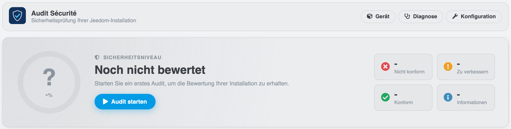
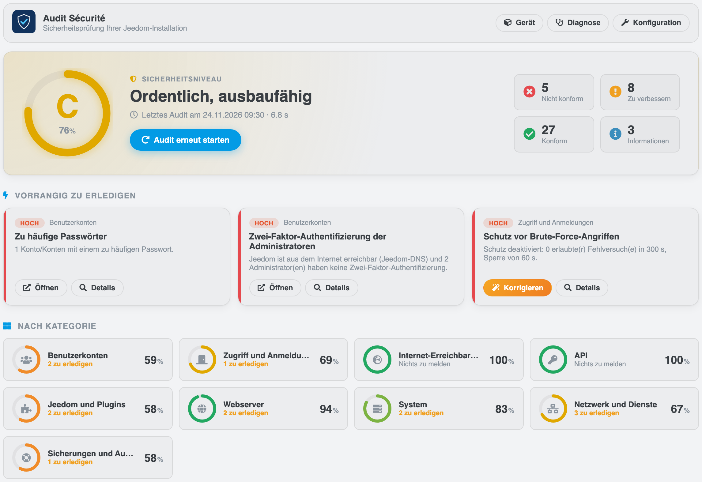
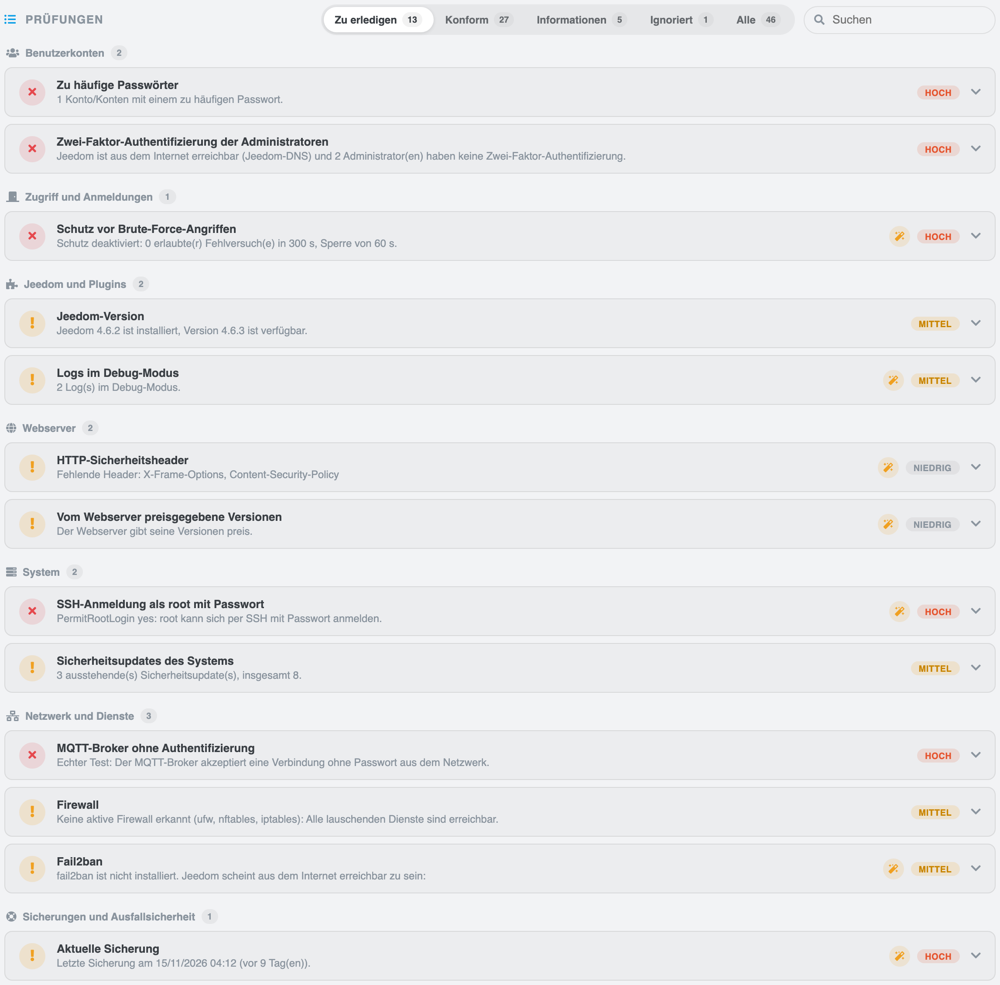
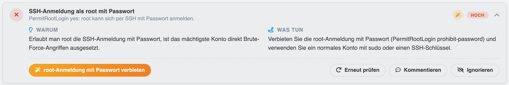
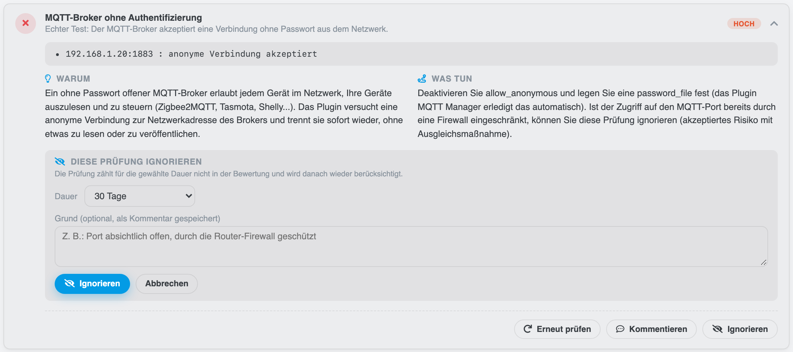
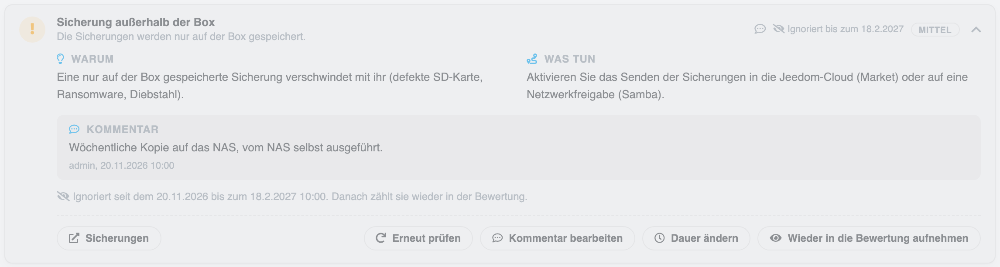
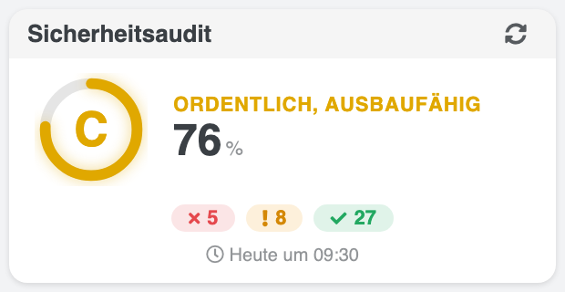
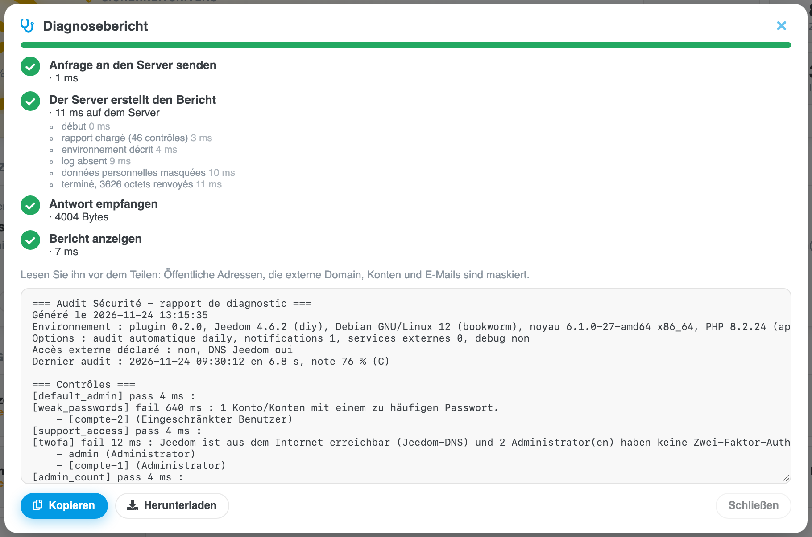

# Plugin Sicherheitsaudit

Sicherheitsaudit prüft die Sicherheit Ihrer Jeedom-Installation und vergibt eine Bewertung in Prozent mit einer Note von **A** (sehr gut) bis **F** (dringend zu überarbeiten). Für jeden Punkt erklärt das Plugin das Risiko und das Vorgehen. Viele Punkte lassen sich mit einem Klick im Plugin korrigieren.

## Installation

Installieren Sie das Plugin aus dem Market und aktivieren Sie es. Das Gerät **Sicherheitsaudit** wird automatisch angelegt. Es sind keine Abhängigkeiten nötig.

Voraussetzungen: Jeedom 4.4 oder neuer. Einige Systemprüfungen (Systempasswörter, Firewall, SSH) setzen voraus, dass Jeedom `sudo` nutzen kann, was bei einer Standardinstallation der Fall ist. Ohne `sudo` werden sie als **Nicht prüfbar** markiert und zählen nicht zur Bewertung.

## Ein Audit starten

Öffnen Sie *Plugins > Monitoring > Sicherheitsaudit* und klicken Sie auf **Audit starten**. Das Audit dauert je nach Box einige Sekunden bis eine Minute. Es ändert nichts: Es liest nur die Konfiguration.

Der Bericht zeigt:

- die **Note** und die **Bewertung** in Prozent;
- **Vorrangig zu erledigen**: die drei schwersten Probleme, mit einer Schaltfläche zum Korrigieren oder Anzeigen;
- die Zahl der Prüfungen **Nicht konform**, **Zu verbessern**, **Konform**, die **Informationen**, die **Nicht prüfbaren** und die von Ihnen **Ignorierten** Prüfungen;
- eine Bewertung pro Kategorie: Klicken Sie auf eine Kategorie, um ihre Prüfungen anzuzeigen;
- die Liste der Prüfungen. Standardmäßig werden nur die Prüfungen **Zu erledigen** angezeigt. Klicken Sie auf eine Prüfung, um die Details, die Bedeutung und das Vorgehen zu sehen.

## Berechnung der Bewertung

Jede Prüfung hat einen Schweregrad, der ihr Gewicht in der Bewertung bestimmt:

| Schweregrad | Gewicht |
|-------------|---------|
| Kritisch    | 20      |
| Hoch        | 10      |
| Mittel      | 5       |
| Niedrig     | 2       |
| Info        | 0       |

Eine **konforme** Prüfung bringt alle Punkte, eine Prüfung **Zu verbessern** die Hälfte, eine **nicht konforme** keine. Informationen, nicht prüfbare und ignorierte Prüfungen zählen nicht.

| Note | Mindestbewertung |
|------|------------------|
| A    | 90               |
| B    | 80               |
| C    | 65               |
| D    | 50               |
| E    | 35               |
| F    | 0                |

Eine nicht behobene **kritische** Lücke (Standardpasswort von admin, herunterladbare Sicherungen...) begrenzt die Note auf **D**, auch bei hoher Bewertung.

## Ein Problem beheben

Je nach Prüfung bieten die Details:

- eine Schaltfläche zur **automatischen Korrektur** (Zauberstab-Symbol). Ein Fenster erklärt vorher, was geändert wird und welche Folgen das hat. Die Prüfung wird direkt danach erneut ausgeführt;
- einen **Link** zur Jeedom-Seite, auf der die Korrektur erfolgt (Benutzer, Updates, Einstellungen...);
- **Erneut prüfen**, um nach einer manuellen Korrektur nur diese Prüfung erneut auszuführen;
- **Ignorieren**, wenn Sie das Risiko akzeptieren (z. B. ein bewusst offener Dienst). Die Prüfung zählt nicht mehr zur Bewertung und bleibt im Filter **Ignoriert** sichtbar, wo Sie sie wieder aufnehmen können. Wählen Sie eine Dauer (7 Tage, 30 Tage, 3 Monate, 1 Jahr oder unbegrenzt): Danach zählt die Prüfung wieder zur Bewertung und eine Jeedom-Nachricht weist Sie darauf hin. Sie können auch den Grund notieren, der als Kommentar gespeichert wird;
- **Kommentieren**, um eine Notiz zu einer Prüfung festzuhalten (Ausgleichsmaßnahme, getroffene Entscheidung...). Ein Sprechblasen-Symbol kennzeichnet kommentierte Prüfungen, und die Suche umfasst auch Kommentare.

Im Filter **Ignoriert** zeigt die Karte das Enddatum und den Kommentar; mit **Dauer ändern** und **Wieder in die Bewertung aufnehmen** lässt sich die Entscheidung ändern:

> **Achtung**
>
> Korrekturen am System (SSH, Apache, fail2ban) erfolgen mit Vorsicht: Die Konfiguration wird vor der Anwendung getestet und bei einem Fehler die alte wiederhergestellt. Erstellen Sie dennoch vorher eine Sicherung und lesen Sie die Bestätigungsmeldung genau, insbesondere bei SSH.

## Durchgeführte Prüfungen

| Kategorie | Prüfung | Schweregrad | Korrektur |
|---|---|---|---|
| Konten | Admin-Konto mit dem Passwort „admin“ | Kritisch | Link |
| Konten | Zu häufige Passwörter (jeedom, 123456, qwertz, Benutzername...) | Hoch | Link |
| Konten | Offen gelassener Jeedom-Supportzugang | Mittel | Automatisch |
| Konten | Zwei-Faktor-Authentifizierung der Administratoren (bei Zugriff aus dem Internet) | Hoch | Link |
| Konten | Mehr als 3 Administratoren | Niedrig | Link |
| Konten | Konten ohne Anmeldung seit 6 Monaten | Niedrig | Link |
| Zugriff | Schutz vor Brute-Force-Angriffen (IP-Sperre) | Hoch | Automatisch |
| Zugriff | Für das ganze Internet offene Whitelist | Hoch | Automatisch |
| Zugriff | Sitzungen länger als 7 Tage | Niedrig | Automatisch |
| Zugriff | Externer Zugriff über HTTP statt HTTPS | Hoch | Link |
| Internet-Erreichbarkeit | Per UPnP am Internet-Router geöffnete Ports, insbesondere zu Jeedom | Hoch | - |
| Internet-Erreichbarkeit | Von Shodan erkannte offene Ports und bekannte Lücken *(Option)* | Hoch | - |
| Internet-Erreichbarkeit | IP-Adresse auf Blacklists (Spamhaus, Barracuda, SpamCop) *(Option)* | Mittel | - |
| Internet-Erreichbarkeit | HTTPS-Zertifikat des externen Zugriffs (Gültigkeit, Ablauf) | Hoch | Link |
| API | Offene APIs, während Jeedom aus dem Internet erreichbar ist | Mittel | Automatisch |
| API | Zu kurze API-Schlüssel | Mittel | Automatisch |
| Jeedom | Core-Update verfügbar | Mittel | Link |
| Jeedom | Zu aktualisierende Plugins | Niedrig | Link |
| Jeedom | Außerhalb des Markets installierte Plugins | Info | Link |
| Jeedom | Logs im Debug-Modus | Mittel | Automatisch |
| Webserver | Herunterladbare Ordner log und backup sowie Konfigurationsdateien | Kritisch | Automatisch |
| Webserver | Fehlende HTTP-Sicherheitsheader | Niedrig | Automatisch |
| Webserver | Preisgegebene Apache- und PHP-Versionen | Niedrig | Automatisch |
| Webserver | PHP-Version ohne Support | Hoch | - |
| System | Debian-Version ohne Support | Hoch | - |
| System | Standard-Systempasswörter (Mjeedom96, raspberry...) | Kritisch | - |
| System | SSH-Anmeldung als root mit Passwort | Hoch | Automatisch |
| System | SSH-Authentifizierung per Passwort | Niedrig | - |
| System | Zeitsynchronisierung (NTP) | Niedrig | Automatisch |
| System | Ausstehende Debian-Sicherheitsupdates | Mittel | Link |
| System | Für alle lesbare Konfigurationsdatei | Mittel | Automatisch |
| System | Für alle beschreibbare Dateien | Mittel | Automatisch |
| System | Ordner backup, log und core/config für andere Konten zugänglich | Mittel | Automatisch |
| System | SUID/SGID-Dateien in Jeedom | Hoch | - |
| System | Ausstehender Neustart nach einem Update | Niedrig | - |
| System | sudo-Rechte des Webservers | Info | - |
| Netzwerk | Aktive Firewall | Mittel | - |
| Netzwerk | fail2ban installiert und aktiv (zählt nur zur Bewertung, wenn Jeedom aus dem Internet erreichbar ist) | Mittel | Automatisch |
| Netzwerk | Datenbank aus dem Netzwerk erreichbar | Hoch | - |
| Netzwerk | Zugangsdaten der Datenbank | Mittel | - |
| Netzwerk | MQTT-Broker ohne Authentifizierung | Hoch | - |
| Netzwerk | Gefährliche lauschende Dienste (Telnet, FTP, Docker-API, VNC, Redis...) | Hoch | - |
| Netzwerk | Im Netzwerk lauschende Dienste | Info | - |
| Sicherungen | Sicherung jünger als 7 Tage | Hoch | Automatisch |
| Sicherungen | Sicherung außerhalb der Box | Mittel | Link |
| Sicherungen | Speicherplatz | Niedrig | Link |

So funktionieren die sensiblen Prüfungen:

- **Passwörter**: Das Plugin vergleicht die Passwörter direkt anhand ihres Hashes mit einer kurzen Liste häufiger Passwörter. Es meldet sich nicht an und schreibt kein Passwort in die Logs oder den Bericht.
- **Herunterladbare Dateien**: Das Plugin legt eine kleine Testdatei in den Ordnern `log` und `backup` ab, versucht sie über die lokale Oberfläche herunterzuladen und löscht sie anschließend.
- **Debian-Updates**: Das Plugin simuliert ein Update (`apt-get -s upgrade`) anhand der bereits vorhandenen Paketlisten. Es wird nichts installiert.

## Konfiguration

In der Konfiguration des Plugins:

- **Automatisches Audit**: jeden Tag (Standard), jede Woche (montags) oder nie;
- **Bei neuen Problemen benachrichtigen**: fügt eine Nachricht im Jeedom-Nachrichtencenter hinzu, wenn eine bestandene Prüfung nicht mehr besteht;
- **Prüfungen über externe Dienste** (standardmäßig deaktiviert): erlaubt die mit *(Option)* markierten Prüfungen. Die öffentliche IP-Adresse Ihres Anschlusses wird dann an internetdb.shodan.io und an die Blacklists zen.spamhaus.org, b.barracudacentral.org und bl.spamcop.net (DNS-Abfragen) gesendet, sowie an api.ipify.org, wenn der Internet-Router sie nicht per UPnP liefert. Ohne diese Option verlassen keine Daten Ihr Netzwerk.

## Gerät und Szenarien

Das Gerät **Sicherheitsaudit** bietet diese Befehle:

| Befehl | Typ | Beschreibung |
|---|---|---|
| Bewertung | Info numerisch, historisiert | Bewertung von 0 bis 100 |
| Note | Info Text | Note von A bis F |
| Schwere Probleme | Info numerisch, historisiert | Nicht konforme Prüfungen mit kritischem oder hohem Schweregrad |
| Nicht konform | Info numerisch | Anzahl nicht konformer Prüfungen |
| Zu verbessern | Info numerisch | Anzahl zu verbessernder Prüfungen |
| Letztes Audit | Info Text | Datum des letzten Audits |
| Zusammenfassung | Info Text | Z. B. „72 % (C): 2 nicht konform, 5 zu verbessern“ |
| Audit starten | Aktion | Startet das vollständige Audit erneut |

Die Befehlsnamen werden beim Anlegen des Geräts in der Sprache von Jeedom vergeben.

Beispielszenario: Auslöser `#[Haus][Sicherheitsaudit][Schwere Probleme]#`, Bedingung `#[Haus][Sicherheitsaudit][Schwere Probleme]# > 0`, Aktion: Benachrichtigung auf Ihr Telefon mit dem Befehl **Zusammenfassung**.

Das Widget zeigt Note, Bewertung und Zähler; ein Klick öffnet den Bericht, das Symbol oben rechts startet das Audit erneut.

## Diagnosebericht

Die Schaltfläche **Diagnose** oben auf der Plugin-Seite erstellt einen Bericht für eine Hilfeanfrage. Das Fenster zeigt jeden Schritt und dann den Bericht: Lesen Sie ihn durch und verwenden Sie **Kopieren** oder **Herunterladen**. Die Überschriften des Berichts sind immer auf Französisch.

## Grenzen

- Passwörter werden nur mit einer **kurzen Liste** häufiger Passwörter verglichen: Eine konforme Prüfung beweist nicht, dass ein Passwort stark ist.
- Eine **von Hand angelegte Portweiterleitung** im Internet-Router sieht nur Shodan (Option).
- **Shodan** nennt kein Scandatum und leitet Schwachstellen aus den angegebenen Versionen ab, ohne sie zu testen: Sie können bereits behoben sein.
- Ausstehende **Debian-Updates** werden aus den vorhandenen Paketlisten gelesen: Sind diese alt, ist das Ergebnis nicht zuverlässig (führen Sie `sudo apt update` aus).
- Für das Support-Ende des Systems werden nur **Debian**-Versionen berücksichtigt.
- Das **HTTPS-Zertifikat** ist nicht prüfbar, wenn die Box die externe Adresse aus dem lokalen Netzwerk nicht erreicht (Router ohne NAT-Loopback).

## FAQ

**Woher weiß das Plugin, ob Jeedom aus dem Internet erreichbar ist?** Es kombiniert den in Jeedom eingetragenen externen Zugriff (Jeedom-DNS oder externe Adresse), die UPnP-Weiterleitungen des Internet-Routers zu Jeedom und, wenn die Option aktiviert ist, die von Shodan als offen erkannten Ports. Eine von Hand im Router angelegte Weiterleitung sieht nur Shodan.

**Docker**: Firewall, fail2ban, SSH und Zeitsynchronisierung werden auf dem Host-System verwaltet. Diese Prüfungen werden als nicht prüfbar markiert.

**Eine Prüfung betrifft mich nicht**: Verwenden Sie **Ignorieren**. Sie zählt dann nicht mehr zur Bewertung.

**Die Apache-Korrektur wurde angewendet, aber die Prüfung schlägt weiter fehl**: Apache wird einige Sekunden nach der Korrektur neu geladen. Klicken Sie auf **Erneut prüfen**.

**Ein Problem melden**: Stellen Sie in der Konfiguration des Plugins die **Log-Stufe** auf **Debug** (Bereich Logs und Überwachung) und speichern Sie, starten Sie das Audit erneut und klicken Sie dann oben auf der Plugin-Seite auf **Diagnose**. Hängen Sie die heruntergeladene Datei an Ihre Nachricht im Forum an. Sie enthält die Umgebung, das Ergebnis jeder Prüfung und das Ende des Logs; öffentliche IP-Adressen, die externe Domain, Konten und E-Mails sind maskiert, und Passwörter werden nie ins Log geschrieben. Lesen Sie sie vor dem Teilen und stellen Sie danach die Log-Stufe wieder auf Standard.
