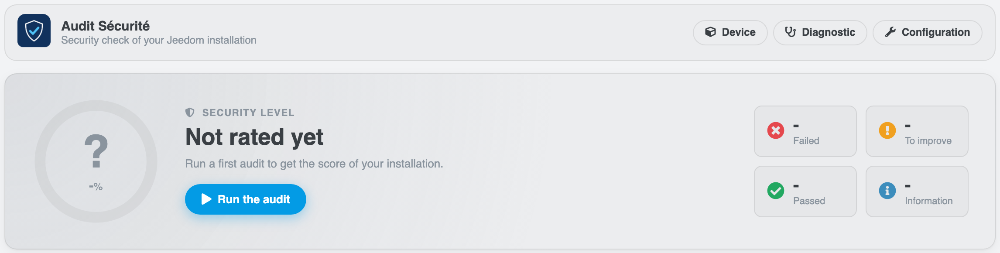
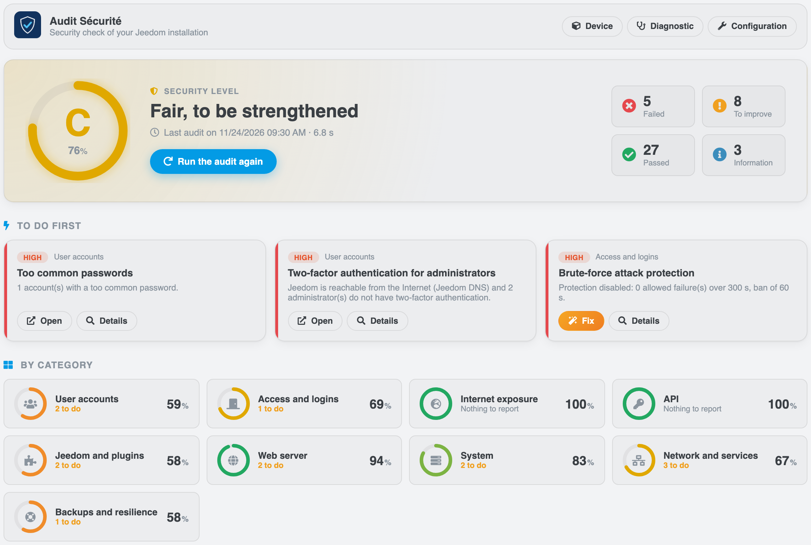
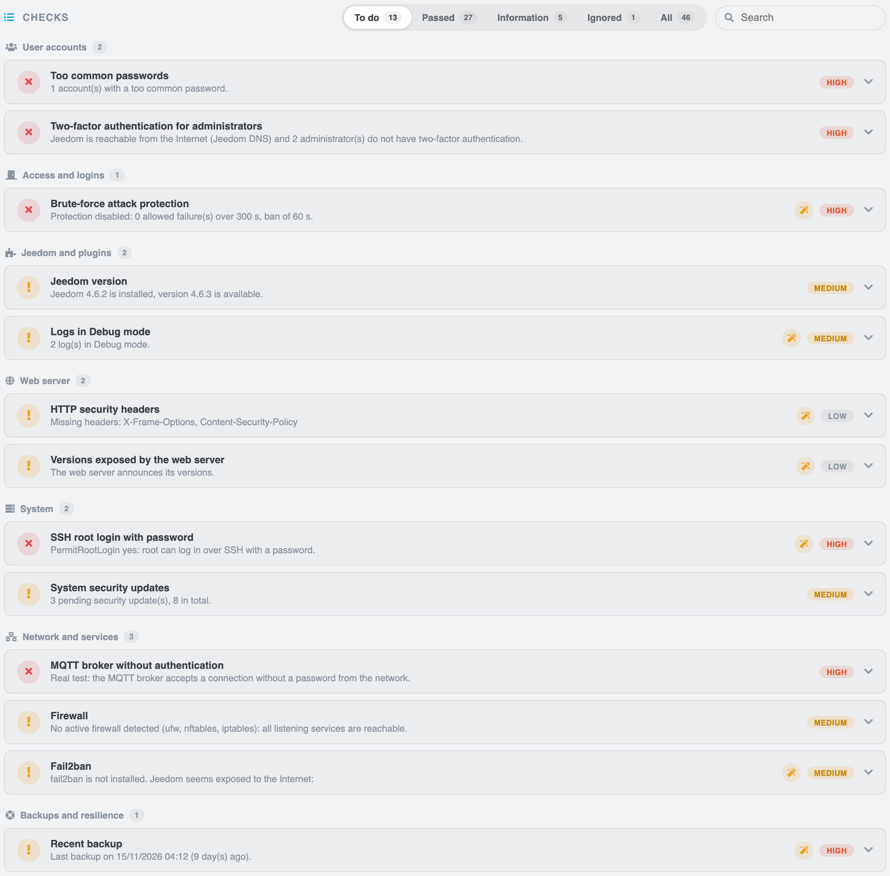
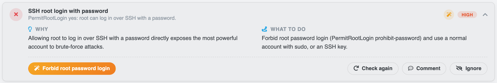
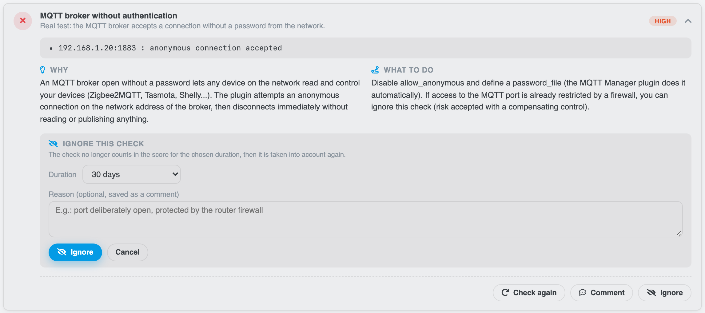
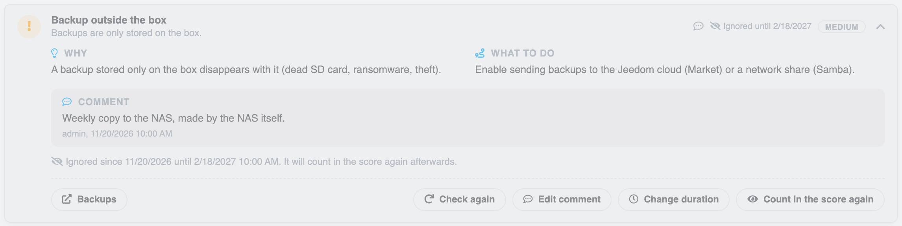
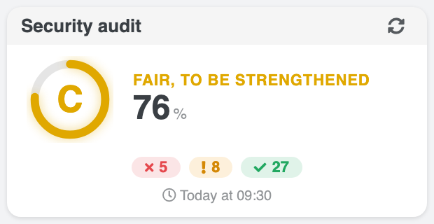
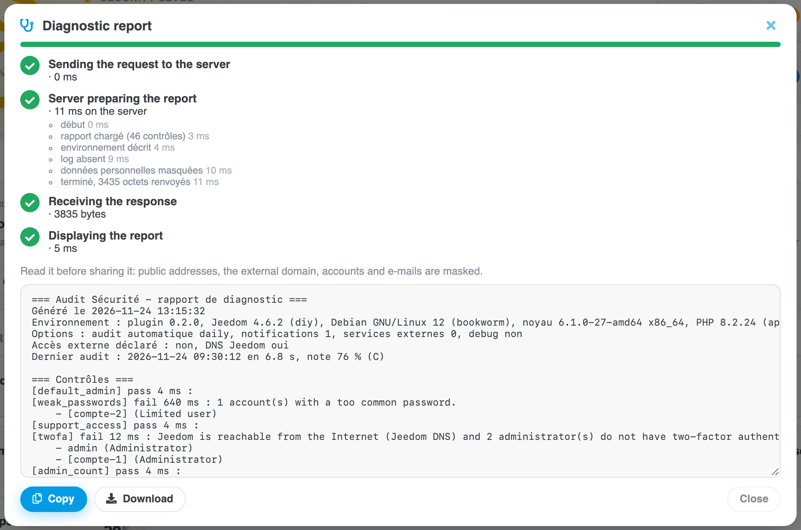

# Security Audit plugin

Security Audit checks the security of your Jeedom installation and gives it a score as a percentage, with a grade from **A** (very good) to **F** (to be fixed urgently). For each point, the plugin explains the risk and what to do. Many points can be fixed in one click from the plugin.

## Installation

Install the plugin from the Market, then enable it. The **Security audit** device is created automatically. No dependency is needed.

Requirements: Jeedom 4.4 or later. Some system checks (system passwords, firewall, SSH) need Jeedom to be able to use `sudo`, which is the case on a standard installation. Without `sudo`, they are marked **Not verifiable** and do not count in the score.

## Running an audit

Open *Plugins > Monitoring > Security Audit* and click **Run the audit**. The audit takes from a few seconds to a minute depending on the box. It does not change anything: it only reads the configuration.

The report shows:

- the **grade** and the **score** as a percentage;
- **To do first**: the three most serious issues, with a button to fix or show them;
- the number of **Failed**, **To improve** and **Passed** checks, the **Information** items, the **Not verifiable** checks and the ones you have **Ignored**;
- a score per category: click a category to show its checks;
- the list of checks. By default, only the ones **To do** are shown. Click a check to see the details, why it matters and what to do.

## How the score is calculated

Each check has a severity, which gives its weight in the score:

| Severity | Weight |
|----------|--------|
| Critical | 20     |
| High     | 10     |
| Medium   | 5      |
| Low      | 2      |
| Info     | 0      |

A **Passed** check earns all its points, a **To improve** check half of them, a **Failed** check none. Information items, checks that cannot be verified and ignored checks do not count.

| Grade | Minimum score |
|-------|---------------|
| A     | 90            |
| B     | 80            |
| C     | 65            |
| D     | 50            |
| E     | 35            |
| F     | 0             |

An unfixed **critical** vulnerability (default admin password, downloadable backups...) caps the grade at **D**, even if the score is high.

## Fixing an issue

Depending on the check, the details offer:

- an **automatic fix** button (magic wand icon). A window explains what will be changed and its consequences before anything is done. The check is verified again right after;
- a **link** to the Jeedom page where the fix is made (users, updates, settings...);
- **Check again**, to run only this check again after a manual fix;
- **Ignore**, if you accept the risk (for example a service that is deliberately open). The check leaves the score and stays visible in the **Ignored** filter, where you can count it in the score again. Choose a duration (7 days, 30 days, 3 months, 1 year or no limit): when it ends, the check counts in the score again and a Jeedom message tells you. You can also write down the reason, saved as a comment;
- **Comment**, to keep a note on a check (compensating measure, decision taken...). A speech bubble icon marks commented checks, and the search also covers comments.

In the **Ignored** filter, the card shows the end date and the comment; use **Change duration** or **Count in the score again** to go back on the decision:

> **Warning**
>
> Fixes that change the system (SSH, Apache, fail2ban) are made carefully: the configuration is tested before being applied and the previous one is restored if there is an error. Still make a backup first, and read the confirmation message carefully, especially for SSH.

## Checks performed

| Category | Check | Severity | Fix |
|---|---|---|---|
| Accounts | Admin account with the password "admin" | Critical | Link |
| Accounts | Too common passwords (jeedom, 123456, qwerty, login...) | High | Link |
| Accounts | Jeedom support access left open | Medium | Automatic |
| Accounts | Two-factor authentication for administrators (if reachable from the Internet) | High | Link |
| Accounts | More than 3 administrators | Low | Link |
| Accounts | Accounts with no login for 6 months | Low | Link |
| Access | Brute-force protection (IP ban) | High | Automatic |
| Access | Whitelist open to the whole Internet | High | Automatic |
| Access | Sessions longer than 7 days | Low | Automatic |
| Access | External access over HTTP instead of HTTPS | High | Link |
| Internet exposure | Ports opened on the Internet router by UPnP, especially to Jeedom | High | - |
| Internet exposure | Open ports and known vulnerabilities seen by Shodan *(option)* | High | - |
| Internet exposure | IP address on blacklists (Spamhaus, Barracuda, SpamCop) *(option)* | Medium | - |
| Internet exposure | HTTPS certificate of the external access (validity, expiry) | High | Link |
| API | APIs open while Jeedom is reachable from the Internet | Medium | Automatic |
| API | API keys too short | Medium | Automatic |
| Jeedom | Core update available | Medium | Link |
| Jeedom | Plugins to update | Low | Link |
| Jeedom | Plugins installed outside the Market | Info | Link |
| Jeedom | Logs in Debug mode | Medium | Automatic |
| Web server | Downloadable log and backup folders and configuration files | Critical | Automatic |
| Web server | Missing HTTP security headers | Low | Automatic |
| Web server | Apache and PHP versions announced | Low | Automatic |
| Web server | PHP version at end of support | High | - |
| System | Debian version at end of support | High | - |
| System | Default system passwords (Mjeedom96, raspberry...) | Critical | - |
| System | SSH root login with password | High | Automatic |
| System | SSH password authentication | Low | - |
| System | Time synchronization (NTP) | Low | Automatic |
| System | Pending Debian security updates | Medium | Link |
| System | Configuration file readable by everyone | Medium | Automatic |
| System | World-writable files | Medium | Automatic |
| System | backup, log and core/config folders accessible to other accounts | Medium | Automatic |
| System | SUID/SGID files in Jeedom | High | - |
| System | Pending reboot after an update | Low | - |
| System | Web server sudo rights | Info | - |
| Network | Active firewall | Medium | - |
| Network | fail2ban installed and active (counted in the score only if Jeedom is exposed to the Internet) | Medium | Automatic |
| Network | Database reachable from the network | High | - |
| Network | Database credentials | Medium | - |
| Network | MQTT broker without authentication | High | - |
| Network | Dangerous services listening (Telnet, FTP, Docker API, VNC, Redis...) | High | - |
| Network | Services listening on the network | Info | - |
| Backups | Backup less than 7 days old | High | Automatic |
| Backups | Backup sent outside the box | Medium | Link |
| Backups | Disk space | Low | Link |

How the sensitive checks work:

- **Passwords**: the plugin compares the passwords with a short list of common passwords, directly against their hash. It does not log in and never writes a password to the logs or the report.
- **Downloadable files**: the plugin drops a small test file in the `log` and `backup` folders, tries to download it from the local interface, then deletes it.
- **Debian updates**: the plugin simulates an update (`apt-get -s upgrade`) from the package lists already present. Nothing is installed.

## Configuration

In the plugin configuration:

- **Automatic audit**: every day (default), every week (on Mondays) or never;
- **Warn about new issues**: adds a message to the Jeedom message center when a passing check no longer passes;
- **Tests using external services** (disabled by default): allows the checks marked *(option)*. The public IP address of your connection is then sent to internetdb.shodan.io and to the blacklists zen.spamhaus.org, b.barracudacentral.org and bl.spamcop.net (DNS queries), and to api.ipify.org if the Internet router does not give it through UPnP. Without this option, no data leaves your network.

## Device and scenarios

The **Security audit** device provides these commands:

| Command | Type | Description |
|---|---|---|
| Score | Numeric info, historized | Score from 0 to 100 |
| Grade | Text info | Grade from A to F |
| Serious issues | Numeric info, historized | Failed checks of critical or high severity |
| Failed | Numeric info | Number of failed checks |
| To improve | Numeric info | Number of checks to improve |
| Last audit | Text info | Date of the last audit |
| Summary | Text info | E.g. "72% (C): 2 failed, 5 to improve" |
| Run the audit | Action | Runs the full audit again |

Command names are set in the Jeedom language when the device is created.

Scenario example: trigger `#[Home][Security audit][Serious issues]#`, condition `#[Home][Security audit][Serious issues]# > 0`, action: notification on your phone with the **Summary** command.

The widget shows the grade, the score and the counters; a click opens the report, the icon at the top right runs the audit again.

## Diagnostic report

The **Diagnostic** button, at the top of the plugin page, prepares a report to attach to a help request. The window shows each step, then the report: read it, then use **Copy** or **Download**. The headings of the report are always in French.

## Limits

- Passwords are tested against a **short list** of common passwords: a passed check does not prove that a password is strong.
- A **port forward created by hand** on the Internet router is only visible to Shodan (option).
- **Shodan** does not give the date of its scan and infers vulnerabilities from the announced versions, without testing them: they may already be fixed.
- Pending **Debian updates** are read from the package lists already present: if they are old, the result is not reliable (run `sudo apt update`).
- Only **Debian** versions are tracked for the system end of support.
- The **HTTPS certificate** cannot be verified if the box cannot reach the external address from the local network (router without NAT loopback).

## FAQ

**How does the plugin know whether Jeedom is exposed to the Internet?** It combines the external access declared in Jeedom (Jeedom DNS or external address), the UPnP forwards of the Internet router to Jeedom and, if the option is enabled, the ports seen open by Shodan. A forward created by hand on the router is only visible to Shodan.

**Docker**: the firewall, fail2ban, SSH and time synchronization are managed on the host system. These checks are marked not verifiable.

**A check does not apply to me**: use **Ignore**. It no longer counts in the score.

**The Apache fix was applied but the check still fails**: Apache is reloaded a few seconds after the fix. Click **Check again**.

**Reporting a problem**: in the plugin configuration, set the **Log level** to **Debug** (Logs and monitoring panel) and save, run the audit again, then click **Diagnostic** at the top of the plugin page. Attach the downloaded file to your message on the forum. It contains the environment, the result of each check and the end of the log; public IP addresses, the external domain, accounts and e-mails are masked, and passwords are never written to the log. Read it before sharing it, then set the log level back to default.
