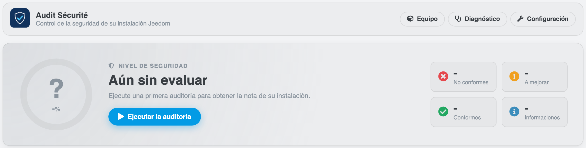
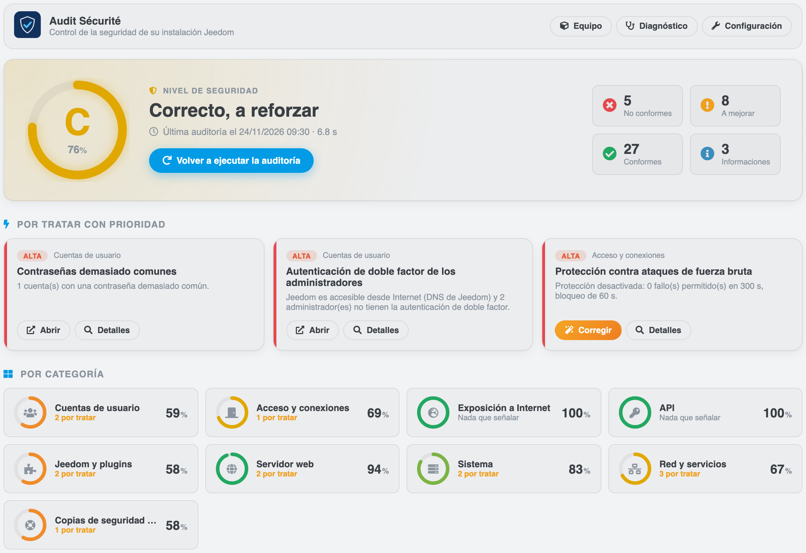
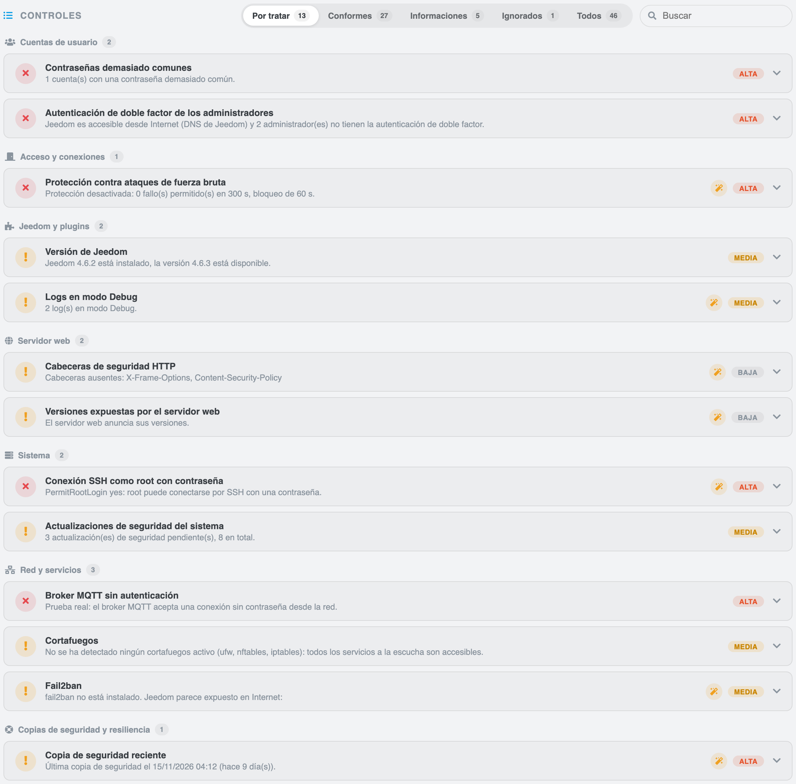
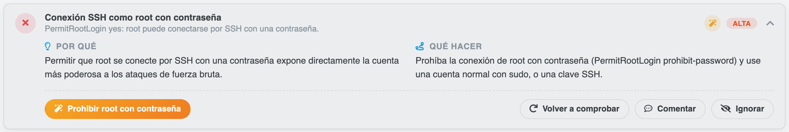
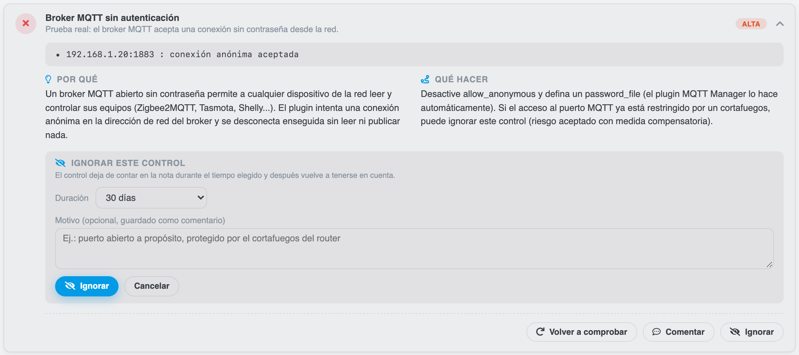
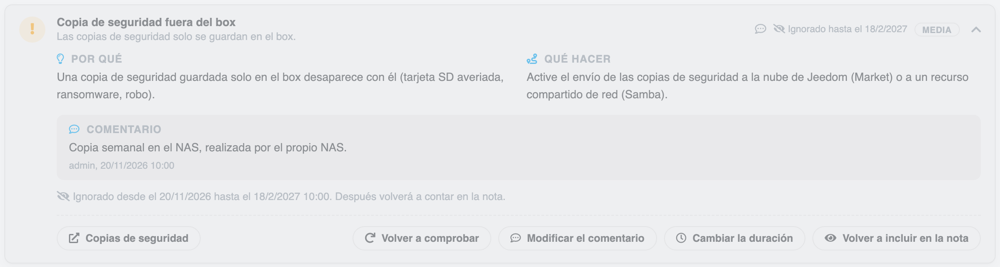
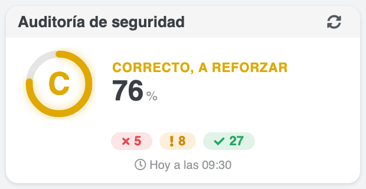
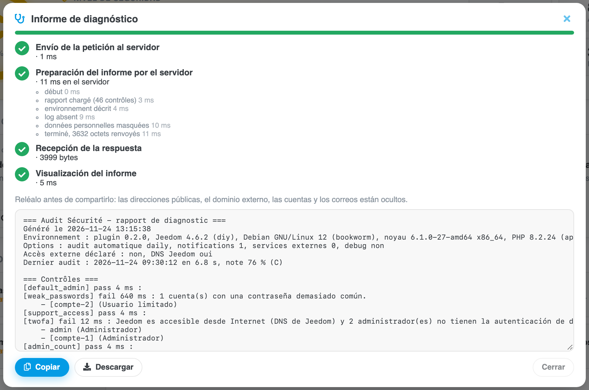

# Plugin Auditoría de seguridad

Auditoría de seguridad comprueba la seguridad de su instalación Jeedom y le asigna una nota en porcentaje, con una letra de la **A** (muy bien) a la **F** (a revisar con urgencia). Para cada punto, el plugin explica el riesgo y qué hacer. Muchos puntos se corrigen con un clic desde el plugin.

## Instalación

Instale el plugin desde el Market y actívelo. El equipo **Auditoría de seguridad** se crea automáticamente. No se necesita ninguna dependencia.

Requisitos: Jeedom 4.4 o superior. Algunos controles del sistema (contraseñas del sistema, cortafuegos, SSH) necesitan que Jeedom pueda usar `sudo`, lo que ocurre en una instalación estándar. Sin `sudo`, se marcan como **No verificable** y no cuentan en la nota.

## Ejecutar una auditoría

Abra *Plugins > Monitoring > Auditoría de seguridad* y haga clic en **Ejecutar la auditoría**. La auditoría tarda de unos segundos a un minuto según el box. No modifica nada: solo lee la configuración.

El informe muestra:

- la **letra** y la **nota** en porcentaje;
- **Por tratar con prioridad**: los tres problemas más graves, con un botón para corregirlos o mostrarlos;
- el número de controles **No conformes**, **A mejorar** y **Conformes**, las **Informaciones**, los controles **No verificables** y los que ha **Ignorado**;
- una nota por categoría: haga clic en una categoría para mostrar sus controles;
- la lista de controles. Por defecto, solo se muestran los **Por tratar**. Haga clic en un control para ver el detalle, por qué es importante y qué hacer.

## Cálculo de la nota

Cada control tiene una gravedad, que determina su peso en la nota:

| Gravedad | Peso |
|----------|------|
| Crítica  | 20   |
| Alta     | 10   |
| Media    | 5    |
| Baja     | 2    |
| Info     | 0    |

Un control **Conforme** aporta todos sus puntos, un control **A mejorar** la mitad, un control **No conforme** ninguno. Las informaciones, los controles no verificables y los ignorados no cuentan.

| Letra | Nota mínima |
|-------|-------------|
| A     | 90          |
| B     | 80          |
| C     | 65          |
| D     | 50          |
| E     | 35          |
| F     | 0           |

Un fallo **crítico** sin corregir (contraseña admin por defecto, copias de seguridad descargables...) limita la letra a **D**, aunque la nota sea alta.

## Corregir un problema

Según el control, el detalle propone:

- un botón de **corrección automática** (icono de varita mágica). Una ventana explica qué se va a modificar y sus consecuencias antes de cualquier acción. El control se vuelve a comprobar justo después;
- un **enlace** a la página de Jeedom donde hacer la corrección (usuarios, actualizaciones, configuración...);
- **Volver a comprobar**, para ejecutar solo este control después de una corrección manual;
- **Ignorar**, si acepta el riesgo (por ejemplo un servicio abierto a propósito). El control sale de la nota y sigue visible en el filtro **Ignorados**, desde donde puede volver a incluirlo. Elija una duración (7 días, 30 días, 3 meses, 1 año o sin límite): al terminar, el control vuelve a contar en la nota y un mensaje de Jeedom le avisa. También puede anotar el motivo, guardado como comentario;
- **Comentar**, para guardar una nota sobre un control (medida compensatoria, decisión tomada...). Un icono de burbuja señala los controles comentados, y la búsqueda también abarca los comentarios.

En el filtro **Ignorados**, la tarjeta indica la fecha de fin y el comentario; **Cambiar la duración** y **Volver a incluir en la nota** permiten revisar la decisión:

> **Atención**
>
> Las correcciones que afectan al sistema (SSH, Apache, fail2ban) se hacen con precaución: la configuración se prueba antes de aplicarse y la anterior se restaura en caso de error. Aun así, haga una copia de seguridad antes y lea bien el mensaje de confirmación, sobre todo para SSH.

## Controles realizados

| Categoría | Control | Gravedad | Corrección |
|---|---|---|---|
| Cuentas | Cuenta admin con la contraseña «admin» | Crítica | Enlace |
| Cuentas | Contraseñas demasiado comunes (jeedom, 123456, qwerty, usuario...) | Alta | Enlace |
| Cuentas | Acceso de soporte de Jeedom abierto | Media | Automática |
| Cuentas | Autenticación de doble factor de los administradores (si hay acceso desde Internet) | Alta | Enlace |
| Cuentas | Más de 3 administradores | Baja | Enlace |
| Cuentas | Cuentas sin conexión desde hace 6 meses | Baja | Enlace |
| Acceso | Protección contra la fuerza bruta (bloqueo de IP) | Alta | Automática |
| Acceso | Lista blanca abierta a todo Internet | Alta | Automática |
| Acceso | Sesiones de más de 7 días | Baja | Automática |
| Acceso | Acceso externo en HTTP en lugar de HTTPS | Alta | Enlace |
| Exposición a Internet | Puertos abiertos en el router de Internet por UPnP, en particular hacia Jeedom | Alta | - |
| Exposición a Internet | Puertos abiertos y fallos conocidos vistos por Shodan *(opción)* | Alta | - |
| Exposición a Internet | Dirección IP en listas negras (Spamhaus, Barracuda, SpamCop) *(opción)* | Media | - |
| Exposición a Internet | Certificado HTTPS del acceso externo (validez, caducidad) | Alta | Enlace |
| API | API abiertas mientras Jeedom es accesible desde Internet | Media | Automática |
| API | Claves API demasiado cortas | Media | Automática |
| Jeedom | Actualización del core disponible | Media | Enlace |
| Jeedom | Plugins por actualizar | Baja | Enlace |
| Jeedom | Plugins instalados fuera del Market | Info | Enlace |
| Jeedom | Logs en modo Debug | Media | Automática |
| Servidor web | Carpetas log y backup y archivos de configuración descargables | Crítica | Automática |
| Servidor web | Cabeceras de seguridad HTTP ausentes | Baja | Automática |
| Servidor web | Versiones de Apache y PHP anunciadas | Baja | Automática |
| Servidor web | Versión de PHP sin soporte | Alta | - |
| Sistema | Versión de Debian sin soporte | Alta | - |
| Sistema | Contraseñas de sistema por defecto (Mjeedom96, raspberry...) | Crítica | - |
| Sistema | Conexión SSH como root con contraseña | Alta | Automática |
| Sistema | Autenticación SSH por contraseña | Baja | - |
| Sistema | Sincronización de la hora (NTP) | Baja | Automática |
| Sistema | Actualizaciones de seguridad de Debian pendientes | Media | Enlace |
| Sistema | Archivo de configuración legible por todos | Media | Automática |
| Sistema | Archivos modificables por todos | Media | Automática |
| Sistema | Carpetas backup, log y core/config accesibles para otras cuentas | Media | Automática |
| Sistema | Archivos SUID/SGID en Jeedom | Alta | - |
| Sistema | Reinicio pendiente tras una actualización | Baja | - |
| Sistema | Permisos sudo del servidor web | Info | - |
| Red | Cortafuegos activo | Media | - |
| Red | fail2ban instalado y activo (cuenta en la nota solo si Jeedom está expuesto en Internet) | Media | Automática |
| Red | Base de datos accesible desde la red | Alta | - |
| Red | Credenciales de la base de datos | Media | - |
| Red | Broker MQTT sin autenticación | Alta | - |
| Red | Servicios peligrosos a la escucha (Telnet, FTP, API de Docker, VNC, Redis...) | Alta | - |
| Red | Servicios a la escucha en la red | Info | - |
| Copias de seguridad | Copia de seguridad de menos de 7 días | Alta | Automática |
| Copias de seguridad | Copia de seguridad enviada fuera del box | Media | Enlace |
| Copias de seguridad | Espacio en disco | Baja | Enlace |

Cómo se realizan los controles sensibles:

- **Contraseñas**: el plugin compara las contraseñas con una breve lista de contraseñas comunes, directamente con su huella. No inicia sesión y no escribe ninguna contraseña en los logs ni en el informe.
- **Archivos descargables**: el plugin deposita un pequeño archivo testigo en las carpetas `log` y `backup`, intenta descargarlo desde la interfaz local y luego lo elimina.
- **Actualizaciones de Debian**: el plugin simula una actualización (`apt-get -s upgrade`) a partir de las listas de paquetes ya presentes. No se instala nada.

## Configuración

En la configuración del plugin:

- **Auditoría automática**: todos los días (por defecto), todas las semanas (el lunes) o nunca;
- **Avisar de nuevos problemas**: añade un mensaje en el centro de mensajes de Jeedom cuando un control conforme deja de serlo;
- **Pruebas mediante servicios externos** (desactivado por defecto): autoriza los controles marcados *(opción)*. La dirección IP pública de su conexión se envía entonces a internetdb.shodan.io y a las listas negras zen.spamhaus.org, b.barracudacentral.org y bl.spamcop.net (consultas DNS), y a api.ipify.org si el router de Internet no la proporciona por UPnP. Sin esta opción, ningún dato sale de su red.

## Equipo y escenarios

El equipo **Auditoría de seguridad** ofrece estos comandos:

| Comando | Tipo | Descripción |
|---|---|---|
| Nota | Info numérica, historizada | Nota de 0 a 100 |
| Letra | Info texto | Letra de la A a la F |
| Problemas graves | Info numérica, historizada | Controles de gravedad crítica o alta no conformes |
| No conformes | Info numérica | Número de controles no conformes |
| A mejorar | Info numérica | Número de controles a mejorar |
| Última auditoría | Info texto | Fecha de la última auditoría |
| Resumen | Info texto | P. ej. «72 % (C): 2 no conforme(s), 5 a mejorar» |
| Ejecutar la auditoría | Acción | Vuelve a ejecutar la auditoría completa |

Los nombres de los comandos se asignan en el idioma de Jeedom al crear el equipo.

Ejemplo de escenario: disparador `#[Casa][Auditoría de seguridad][Problemas graves]#`, condición `#[Casa][Auditoría de seguridad][Problemas graves]# > 0`, acción: notificación en su teléfono con el comando **Resumen**.

El widget muestra la letra, la nota y los contadores; un clic abre el informe, el icono de arriba a la derecha vuelve a ejecutar la auditoría.

## Informe de diagnóstico

El botón **Diagnóstico**, en la parte superior de la página del plugin, prepara un informe para adjuntar a una solicitud de ayuda. La ventana muestra cada etapa y después el informe: reléalo y utilice **Copiar** o **Descargar**. Los títulos del informe están siempre en francés.

## Límites

- Las contraseñas se comparan con una **lista corta** de contraseñas comunes: un control conforme no demuestra que una contraseña sea segura.
- Una **redirección de puerto creada a mano** en el router de Internet solo es visible para Shodan (opción).
- **Shodan** no indica la fecha de su escaneo y deduce los fallos de las versiones anunciadas, sin probarlos: pueden estar ya corregidos.
- Las **actualizaciones de Debian** pendientes se leen en las listas de paquetes presentes: si son antiguas, el resultado no es fiable (ejecute `sudo apt update`).
- Solo se siguen las versiones de **Debian** para el fin de soporte del sistema.
- El **certificado HTTPS** no es verificable si el box no puede acceder a la dirección externa desde la red local (router sin NAT loopback).

## Preguntas frecuentes

**¿Cómo sabe el plugin si Jeedom está expuesto en Internet?** Combina el acceso externo declarado en Jeedom (DNS de Jeedom o dirección externa), las redirecciones UPnP del router de Internet hacia Jeedom y, si la opción está activada, los puertos vistos abiertos por Shodan. Una redirección creada a mano en el router solo es visible para Shodan.

**Docker**: el cortafuegos, fail2ban, SSH y la sincronización de la hora se gestionan en el sistema anfitrión. Estos controles se marcan como no verificables.

**Un control no me afecta**: use **Ignorar**. Deja de contar en la nota.

**La corrección de Apache se aplicó pero el control sigue fallando**: Apache se recarga unos segundos después de la corrección. Haga clic en **Volver a comprobar**.

**Informar de un problema**: en la configuración del plugin, ponga el **Nivel de log** en **Debug** (panel Logs y supervisión) y guarde, vuelva a ejecutar la auditoría y haga clic en **Diagnóstico** en la parte superior de la página del plugin. Adjunte el archivo descargado a su mensaje en el foro. Contiene el entorno, el resultado de cada control y el final del log; las direcciones IP públicas, el dominio externo, las cuentas y los correos están ocultos, y las contraseñas nunca se escriben en el log. Reléalo antes de compartirlo y luego vuelva a poner el nivel de log por defecto.
