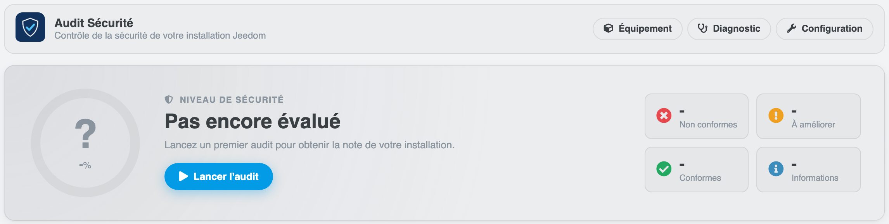
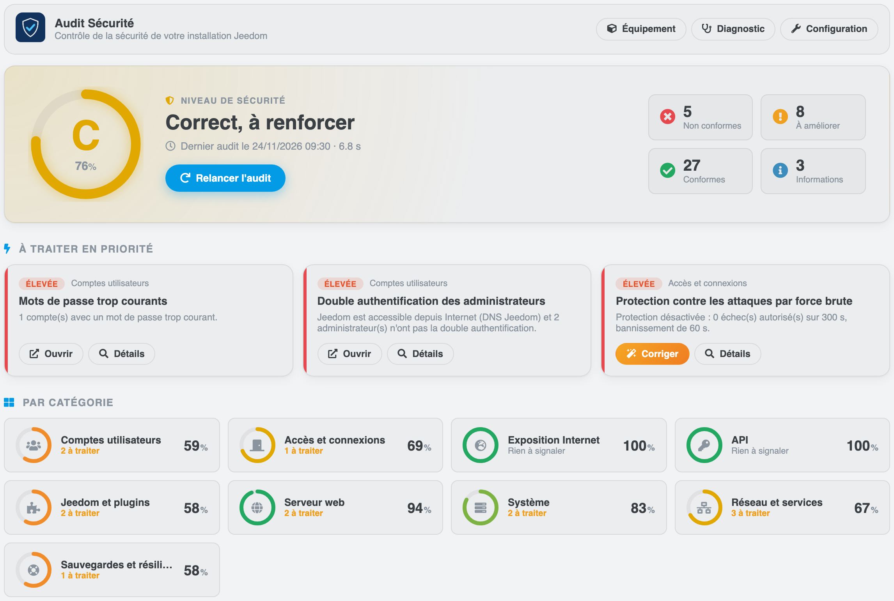
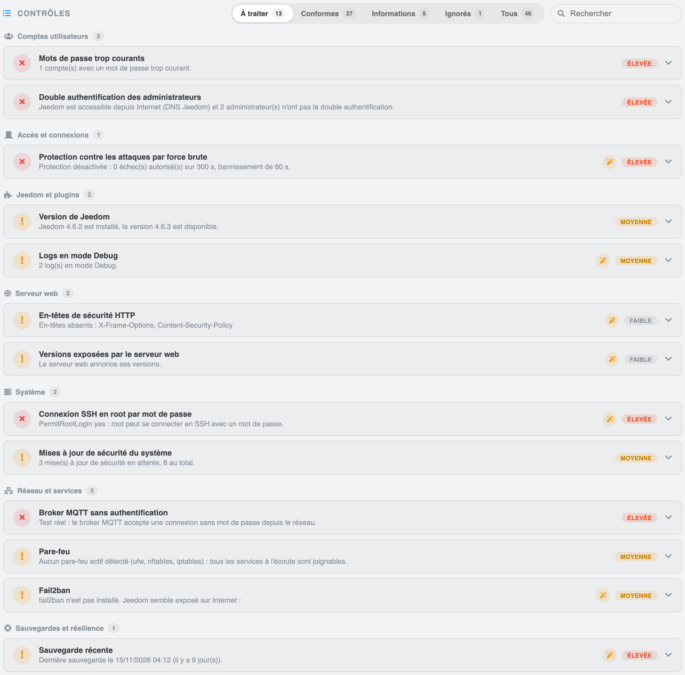
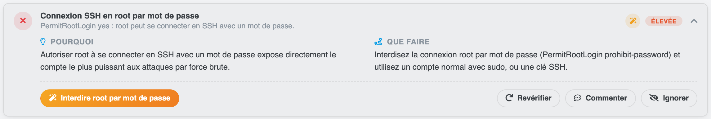
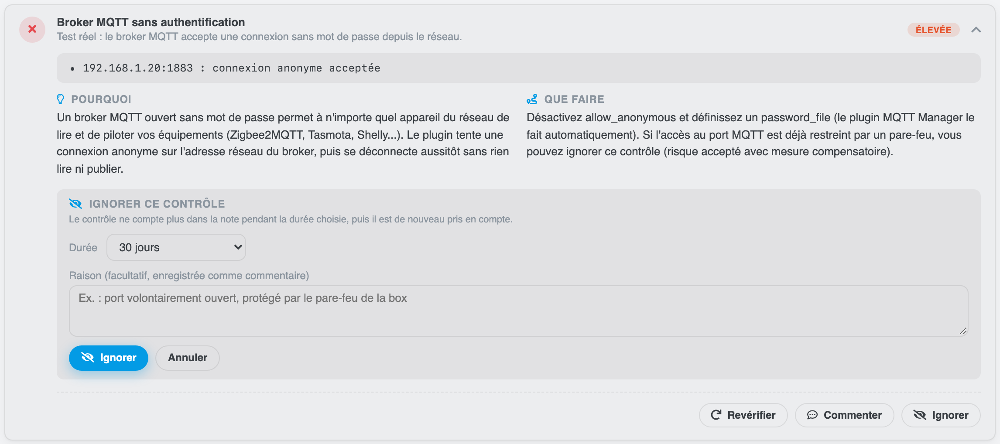
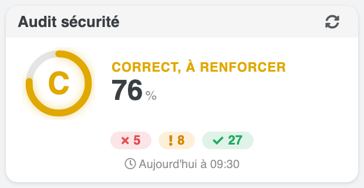
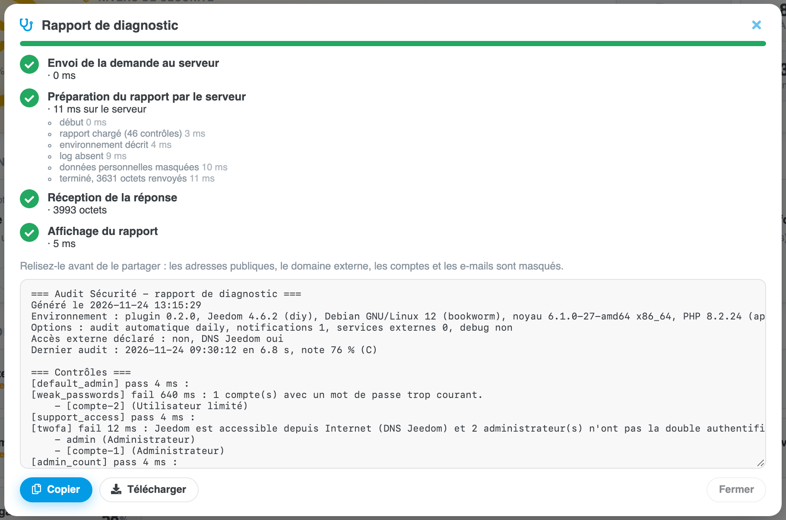

# Plugin Audit Sécurité

Audit Sécurité contrôle la sécurité de votre installation Jeedom et lui donne une note en pourcentage, avec une lettre de **A** (très bien) à **F** (à reprendre d'urgence). Pour chaque point, le plugin explique le risque et ce qu'il faut faire. Beaucoup de points se corrigent en un clic depuis le plugin.

## Installation

Installez le plugin depuis le Market puis activez-le. L'équipement **Audit sécurité** est créé automatiquement. Aucune dépendance n'est nécessaire.

Prérequis : Jeedom 4.4 ou supérieur. Certains contrôles système (mots de passe système, pare-feu, SSH) ont besoin que Jeedom puisse utiliser `sudo`, ce qui est le cas d'une installation standard. Sans `sudo`, ils sont marqués **Non vérifiable** et ne comptent pas dans la note.

## Lancer un audit

Ouvrez *Plugins > Monitoring > Audit Sécurité* et cliquez sur **Lancer l'audit**. L'audit dure de quelques secondes à une minute selon la box. Il ne modifie rien : il ne fait que lire la configuration.

Le rapport affiche :

- la **lettre** et la **note** en pourcentage ;
- **À traiter en priorité** : les trois problèmes les plus graves, avec un bouton pour les corriger ou les afficher ;
- le nombre de contrôles **Non conformes**, **À améliorer**, **Conformes**, les **Informations**, les contrôles **Non vérifiables** et ceux que vous avez **Ignorés** ;
- une note par catégorie : cliquez sur une catégorie pour afficher ses contrôles ;
- la liste des contrôles. Par défaut, seuls ceux **À traiter** sont affichés. Cliquez sur un contrôle pour voir le détail, pourquoi c'est important et que faire.

## Calcul de la note

Chaque contrôle a une gravité, qui donne son poids dans la note :

| Gravité  | Poids |
|----------|-------|
| Critique | 20    |
| Élevée   | 10    |
| Moyenne  | 5     |
| Faible   | 2     |
| Info     | 0     |

Un contrôle **Conforme** rapporte tous ses points, un contrôle **À améliorer** la moitié, un contrôle **Non conforme** aucun. Les informations, les contrôles non vérifiables et les contrôles ignorés ne comptent pas.

| Lettre | Note minimale |
|--------|---------------|
| A      | 90            |
| B      | 80            |
| C      | 65            |
| D      | 50            |
| E      | 35            |
| F      | 0             |

Une faille **critique** non corrigée (mot de passe admin par défaut, sauvegardes téléchargeables...) plafonne la lettre à **D**, même si la note est élevée.

## Corriger un problème

Selon le contrôle, le détail propose :

- un bouton de **correction automatique** (icône baguette magique). Une fenêtre explique ce qui va être modifié et ses conséquences avant toute action. Le contrôle est revérifié juste après ;
- un **lien** vers la page de Jeedom où faire la correction (utilisateurs, mises à jour, configuration...) ;
- **Revérifier**, pour relancer uniquement ce contrôle après une correction manuelle ;
- **Ignorer**, si vous acceptez le risque (par exemple un service volontairement ouvert). Le contrôle sort de la note et reste visible dans le filtre **Ignorés**, d'où vous pouvez le réintégrer. Choisissez une durée (7 jours, 30 jours, 3 mois, 1 an ou sans limite) : à son terme, le contrôle revient dans la note et un message Jeedom vous prévient. Vous pouvez aussi noter la raison, enregistrée comme commentaire ;
- **Commenter**, pour garder une note sur un contrôle (mesure compensatoire, décision prise...). Une icône de bulle signale les contrôles commentés, et la recherche porte aussi sur les commentaires.

Dans le filtre **Ignorés**, la carte indique la date de fin et le commentaire ; **Changer la durée** et **Réintégrer dans la note** permettent de revenir sur la décision :

> **Attention**
>
> Les corrections qui touchent au système (SSH, Apache, fail2ban) sont faites avec précaution : la configuration est testée avant d'être appliquée et l'ancienne est remise en place en cas d'erreur. Faites tout de même une sauvegarde avant, et lisez bien le message de confirmation, notamment pour SSH.

## Contrôles effectués

| Catégorie | Contrôle | Gravité | Correction |
|---|---|---|---|
| Comptes | Compte admin avec le mot de passe « admin » | Critique | Lien |
| Comptes | Mots de passe trop courants (jeedom, 123456, azerty, identifiant...) | Élevée | Lien |
| Comptes | Accès support Jeedom resté ouvert | Moyenne | Automatique |
| Comptes | Double authentification des administrateurs (si accès depuis Internet) | Élevée | Lien |
| Comptes | Plus de 3 administrateurs | Faible | Lien |
| Comptes | Comptes sans connexion depuis 6 mois | Faible | Lien |
| Accès | Protection contre la force brute (bannissement d'IP) | Élevée | Automatique |
| Accès | Liste blanche ouverte à tout Internet | Élevée | Automatique |
| Accès | Sessions de plus de 7 jours | Faible | Automatique |
| Accès | Accès externe en HTTP au lieu de HTTPS | Élevée | Lien |
| Exposition Internet | Ports ouverts sur la box Internet par UPnP, en particulier vers Jeedom | Élevée | - |
| Exposition Internet | Ports ouverts et failles connues vus par Shodan *(option)* | Élevée | - |
| Exposition Internet | Adresse IP sur des listes noires (Spamhaus, Barracuda, SpamCop) *(option)* | Moyenne | - |
| Exposition Internet | Certificat HTTPS de l'accès externe (validité, expiration) | Élevée | Lien |
| API | API ouvertes alors que Jeedom est accessible depuis Internet | Moyenne | Automatique |
| API | Clés API trop courtes | Moyenne | Automatique |
| Jeedom | Mise à jour du core disponible | Moyenne | Lien |
| Jeedom | Plugins à mettre à jour | Faible | Lien |
| Jeedom | Plugins installés hors Market | Info | Lien |
| Jeedom | Logs en mode Debug | Moyenne | Automatique |
| Serveur web | Dossiers log, backup et fichiers de configuration téléchargeables | Critique | Automatique |
| Serveur web | En-têtes de sécurité HTTP absents | Faible | Automatique |
| Serveur web | Versions d'Apache et PHP annoncées | Faible | Automatique |
| Serveur web | Version de PHP en fin de support | Élevée | - |
| Système | Version de Debian en fin de support | Élevée | - |
| Système | Mots de passe système par défaut (Mjeedom96, raspberry...) | Critique | - |
| Système | Connexion SSH root par mot de passe | Élevée | Automatique |
| Système | Authentification SSH par mot de passe | Faible | - |
| Système | Synchronisation de l'heure (NTP) | Faible | Automatique |
| Système | Mises à jour de sécurité Debian en attente | Moyenne | Lien |
| Système | Fichier de configuration lisible par tous | Moyenne | Automatique |
| Système | Fichiers modifiables par tous | Moyenne | Automatique |
| Système | Dossiers backup, log et core/config accessibles aux autres comptes | Moyenne | Automatique |
| Système | Fichiers SUID/SGID dans Jeedom | Élevée | - |
| Système | Redémarrage en attente après une mise à jour | Faible | - |
| Système | Droits sudo du serveur web | Info | - |
| Réseau | Pare-feu actif | Moyenne | - |
| Réseau | fail2ban installé et actif (compté dans la note seulement si Jeedom est exposé sur Internet) | Moyenne | Automatique |
| Réseau | Base de données accessible depuis le réseau | Élevée | - |
| Réseau | Identifiants de la base de données | Moyenne | - |
| Réseau | Broker MQTT sans authentification | Élevée | - |
| Réseau | Services dangereux à l'écoute (Telnet, FTP, API Docker, VNC, Redis...) | Élevée | - |
| Réseau | Services à l'écoute sur le réseau | Info | - |
| Sauvegardes | Sauvegarde de moins de 7 jours | Élevée | Automatique |
| Sauvegardes | Sauvegarde envoyée hors de la box | Moyenne | Lien |
| Sauvegardes | Espace disque | Faible | Lien |

Comment sont faits les contrôles sensibles :

- **Mots de passe** : le plugin compare les mots de passe à une courte liste de mots de passe courants, directement avec leur empreinte. Il ne se connecte pas et n'écrit aucun mot de passe dans les logs ou le rapport.
- **Fichiers téléchargeables** : le plugin dépose un petit fichier témoin dans les dossiers `log` et `backup`, essaie de le télécharger depuis l'interface locale puis le supprime.
- **Mises à jour Debian** : le plugin simule une mise à jour (`apt-get -s upgrade`) à partir des listes de paquets déjà présentes. Rien n'est installé.

## Configuration

Dans la configuration du plugin :

- **Audit automatique** : tous les jours (par défaut), toutes les semaines (le lundi) ou jamais ;
- **Prévenir des nouveaux problèmes** : ajoute un message dans le centre de messages de Jeedom quand un contrôle conforme ne l'est plus ;
- **Tests via des services externes** (désactivé par défaut) : autorise les contrôles marqués *(option)*. L'adresse IP publique de votre connexion est alors envoyée à internetdb.shodan.io et aux listes noires zen.spamhaus.org, b.barracudacentral.org et bl.spamcop.net (requêtes DNS), et à api.ipify.org si la box Internet ne la donne pas par UPnP. Sans cette option, aucune donnée ne quitte votre réseau.

## Équipement et scénarios

L'équipement **Audit sécurité** propose ces commandes :

| Commande | Type | Description |
|---|---|---|
| Note | Info numérique, historisée | Note de 0 à 100 |
| Lettre | Info texte | Lettre de A à F |
| Problèmes graves | Info numérique, historisée | Contrôles critiques ou de gravité élevée non conformes |
| Non conformes | Info numérique | Nombre de contrôles non conformes |
| À améliorer | Info numérique | Nombre de contrôles à améliorer |
| Dernier audit | Info texte | Date du dernier audit |
| Résumé | Info texte | Ex. « 72 % (C) : 2 non conforme(s), 5 à améliorer » |
| Lancer l'audit | Action | Relance l'audit complet |

Les noms des commandes sont donnés dans la langue de Jeedom à la création de l'équipement.

Exemple de scénario : déclencheur `#[Maison][Audit sécurité][Problèmes graves]#`, condition `#[Maison][Audit sécurité][Problèmes graves]# > 0`, action : notification sur votre téléphone avec la commande **Résumé**.

Le widget affiche la lettre, la note et les compteurs ; un clic ouvre le rapport, l'icône en haut à droite relance l'audit.

## Rapport de diagnostic

Le bouton **Diagnostic**, en haut de la page du plugin, prépare un rapport à joindre à une demande d'aide. La fenêtre montre chaque étape, puis le rapport : relisez-le, puis utilisez **Copier** ou **Télécharger**. Les intitulés du rapport sont toujours en français.

## Limites

- Le test des mots de passe porte sur une **courte liste** de mots de passe courants : un contrôle conforme ne prouve pas qu'un mot de passe est solide.
- Une **redirection de port créée à la main** dans la box Internet n'est visible que par Shodan (option).
- **Shodan** ne donne pas la date de son scan et déduit les failles des versions annoncées, sans les tester : elles peuvent être déjà corrigées.
- Les **mises à jour Debian** en attente sont lues dans les listes de paquets présentes : si elles sont anciennes, le résultat n'est pas fiable (lancez `sudo apt update`).
- Seules les versions de **Debian** sont suivies pour la fin de support du système.
- Le **certificat HTTPS** n'est pas vérifiable si la box ne peut pas joindre l'adresse externe depuis le réseau local (routeur sans NAT loopback).

## FAQ

**Comment le plugin sait-il si Jeedom est exposé sur Internet ?** Il combine l'accès externe déclaré dans Jeedom (DNS Jeedom ou adresse externe), les redirections UPnP de la box Internet vers Jeedom et, si l'option est activée, les ports vus ouverts par Shodan. Une redirection créée à la main dans la box n'est visible que par Shodan.

**Docker** : le pare-feu, fail2ban, SSH et la synchronisation de l'heure se gèrent sur le système hôte. Ces contrôles sont marqués non vérifiables.

**Un contrôle ne me concerne pas** : utilisez **Ignorer**. Il ne compte plus dans la note.

**La correction Apache a été appliquée mais le contrôle est toujours en échec** : Apache est rechargé quelques secondes après la correction. Cliquez sur **Revérifier**.

**Signaler un problème** : dans la configuration du plugin, passez le **Niveau log** sur **Debug** (cadre Logs et surveillance) et enregistrez, relancez l'audit, puis cliquez sur **Diagnostic** en haut de la page du plugin. Joignez le fichier téléchargé à votre message sur le forum. Il contient l'environnement, le résultat de chaque contrôle et la fin du log ; les adresses IP publiques, le domaine externe, les comptes et les e-mails y sont masqués, et les mots de passe ne sont jamais écrits dans le log. Relisez-le avant de le partager, puis remettez le niveau de log par défaut.
