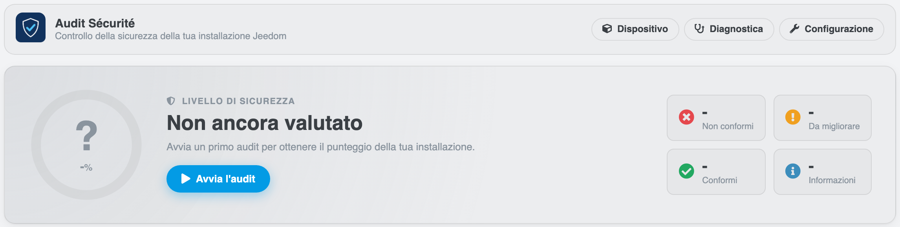
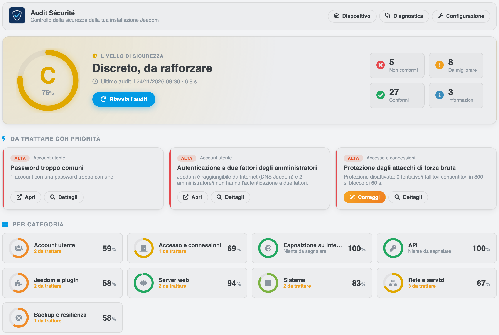
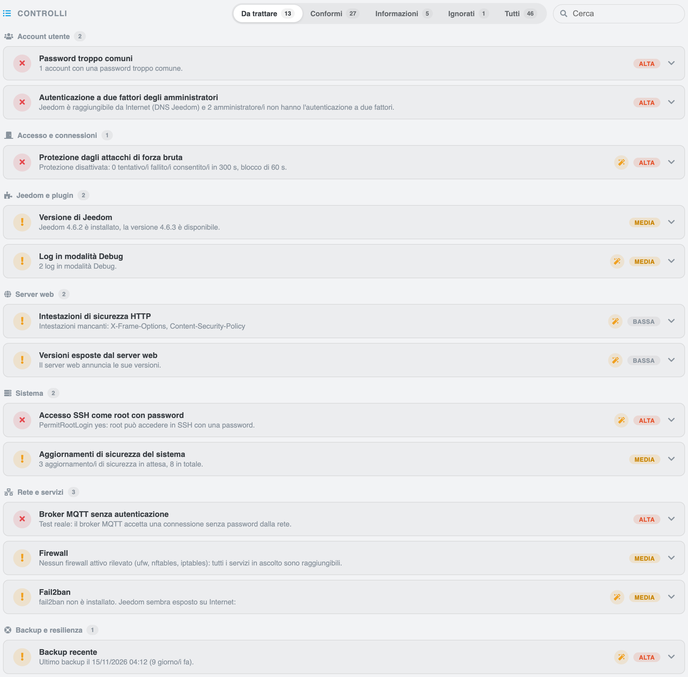
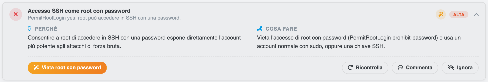
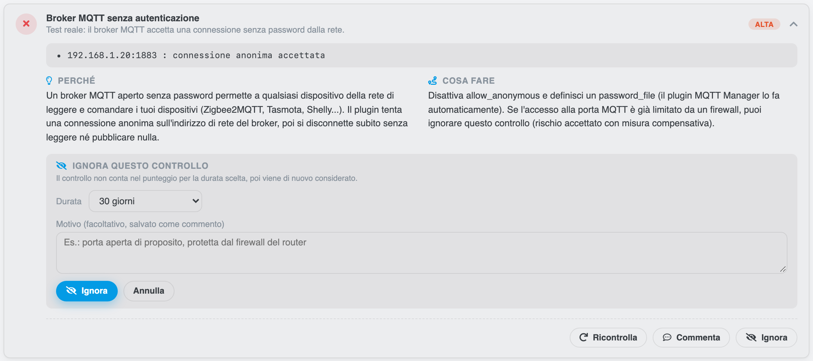
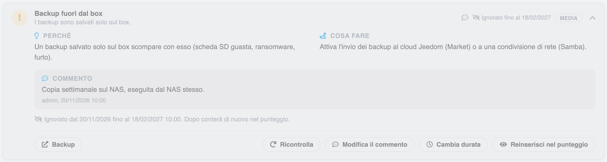
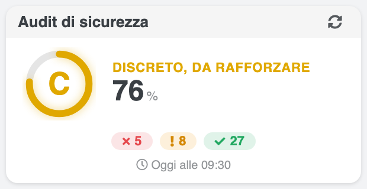
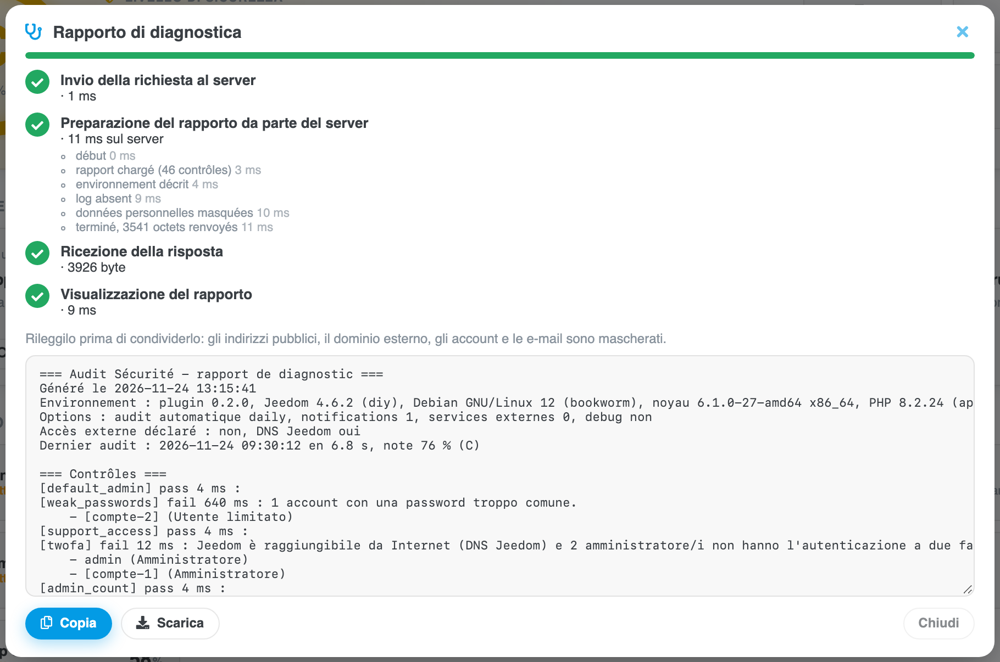

# Plugin Audit di sicurezza

Audit di sicurezza controlla la sicurezza della tua installazione Jeedom e le assegna un punteggio in percentuale, con una lettera da **A** (molto bene) a **F** (da sistemare con urgenza). Per ogni punto, il plugin spiega il rischio e cosa fare. Molti punti si correggono con un clic dal plugin.

## Installazione

Installa il plugin dal Market e attivalo. Il dispositivo **Audit di sicurezza** viene creato automaticamente. Non serve alcuna dipendenza.

Requisiti: Jeedom 4.4 o superiore. Alcuni controlli di sistema (password di sistema, firewall, SSH) richiedono che Jeedom possa usare `sudo`, come avviene in un'installazione standard. Senza `sudo`, vengono segnati come **Non verificabile** e non contano nel punteggio.

## Avviare un audit

Apri *Plugin > Monitoring > Audit di sicurezza* e fai clic su **Avvia l'audit**. L'audit dura da qualche secondo a un minuto a seconda del box. Non modifica nulla: legge soltanto la configurazione.

Il rapporto mostra:

- la **lettera** e il **punteggio** in percentuale;
- **Da trattare con priorità**: i tre problemi più gravi, con un pulsante per correggerli o mostrarli;
- il numero di controlli **Non conformi**, **Da migliorare** e **Conformi**, le **Informazioni**, i controlli **Non verificabili** e quelli che hai **Ignorato**;
- un punteggio per categoria: fai clic su una categoria per mostrarne i controlli;
- l'elenco dei controlli. Per impostazione predefinita vengono mostrati solo quelli **Da trattare**. Fai clic su un controllo per vedere il dettaglio, perché è importante e cosa fare.

## Calcolo del punteggio

Ogni controllo ha una gravità, che determina il suo peso nel punteggio:

| Gravità | Peso |
|---------|------|
| Critica | 20   |
| Alta    | 10   |
| Media   | 5    |
| Bassa   | 2    |
| Info    | 0    |

Un controllo **Conforme** porta tutti i suoi punti, un controllo **Da migliorare** la metà, un controllo **Non conforme** nessuno. Le informazioni, i controlli non verificabili e quelli ignorati non contano.

| Lettera | Punteggio minimo |
|---------|------------------|
| A       | 90               |
| B       | 80               |
| C       | 65               |
| D       | 50               |
| E       | 35               |
| F       | 0                |

Una falla **critica** non corretta (password admin predefinita, backup scaricabili...) limita la lettera a **D**, anche se il punteggio è alto.

## Correggere un problema

A seconda del controllo, il dettaglio propone:

- un pulsante di **correzione automatica** (icona della bacchetta magica). Una finestra spiega cosa verrà modificato e le conseguenze prima di qualsiasi azione. Il controllo viene ripetuto subito dopo;
- un **link** alla pagina di Jeedom in cui fare la correzione (utenti, aggiornamenti, configurazione...);
- **Ricontrolla**, per ripetere solo questo controllo dopo una correzione manuale;
- **Ignora**, se accetti il rischio (ad esempio un servizio aperto volutamente). Il controllo esce dal punteggio e resta visibile nel filtro **Ignorati**, da cui puoi reinserirlo. Scegli una durata (7 giorni, 30 giorni, 3 mesi, 1 anno o senza limite): alla scadenza il controllo torna nel punteggio e un messaggio di Jeedom ti avvisa. Puoi anche annotare il motivo, salvato come commento;
- **Commenta**, per conservare una nota su un controllo (misura compensativa, decisione presa...). Un'icona a fumetto segnala i controlli commentati, e la ricerca include anche i commenti.

Nel filtro **Ignorati**, la scheda indica la data di fine e il commento; **Cambia durata** e **Reinserisci nel punteggio** permettono di rivedere la decisione:

> **Attenzione**
>
> Le correzioni che toccano il sistema (SSH, Apache, fail2ban) sono fatte con cautela: la configurazione viene testata prima di essere applicata e quella precedente viene ripristinata in caso di errore. Fai comunque un backup prima e leggi bene il messaggio di conferma, soprattutto per SSH.

## Controlli effettuati

| Categoria | Controllo | Gravità | Correzione |
|---|---|---|---|
| Account | Account admin con la password «admin» | Critica | Link |
| Account | Password troppo comuni (jeedom, 123456, qwerty, nome utente...) | Alta | Link |
| Account | Accesso di supporto Jeedom rimasto aperto | Media | Automatica |
| Account | Autenticazione a due fattori degli amministratori (se raggiungibile da Internet) | Alta | Link |
| Account | Più di 3 amministratori | Bassa | Link |
| Account | Account senza accessi da 6 mesi | Bassa | Link |
| Accesso | Protezione dalla forza bruta (blocco IP) | Alta | Automatica |
| Accesso | Lista bianca aperta a tutto Internet | Alta | Automatica |
| Accesso | Sessioni più lunghe di 7 giorni | Bassa | Automatica |
| Accesso | Accesso esterno in HTTP invece di HTTPS | Alta | Link |
| Esposizione su Internet | Porte aperte sul router Internet tramite UPnP, in particolare verso Jeedom | Alta | - |
| Esposizione su Internet | Porte aperte e falle note viste da Shodan *(opzione)* | Alta | - |
| Esposizione su Internet | Indirizzo IP su liste nere (Spamhaus, Barracuda, SpamCop) *(opzione)* | Media | - |
| Esposizione su Internet | Certificato HTTPS dell'accesso esterno (validità, scadenza) | Alta | Link |
| API | API aperte mentre Jeedom è raggiungibile da Internet | Media | Automatica |
| API | Chiavi API troppo corte | Media | Automatica |
| Jeedom | Aggiornamento del core disponibile | Media | Link |
| Jeedom | Plugin da aggiornare | Bassa | Link |
| Jeedom | Plugin installati fuori dal Market | Info | Link |
| Jeedom | Log in modalità Debug | Media | Automatica |
| Server web | Cartelle log e backup e file di configurazione scaricabili | Critica | Automatica |
| Server web | Intestazioni di sicurezza HTTP mancanti | Bassa | Automatica |
| Server web | Versioni di Apache e PHP annunciate | Bassa | Automatica |
| Server web | Versione di PHP a fine supporto | Alta | - |
| Sistema | Versione di Debian a fine supporto | Alta | - |
| Sistema | Password di sistema predefinite (Mjeedom96, raspberry...) | Critica | - |
| Sistema | Accesso SSH come root con password | Alta | Automatica |
| Sistema | Autenticazione SSH con password | Bassa | - |
| Sistema | Sincronizzazione dell'ora (NTP) | Bassa | Automatica |
| Sistema | Aggiornamenti di sicurezza Debian in attesa | Media | Link |
| Sistema | File di configurazione leggibile da tutti | Media | Automatica |
| Sistema | File modificabili da tutti | Media | Automatica |
| Sistema | Cartelle backup, log e core/config accessibili agli altri account | Media | Automatica |
| Sistema | File SUID/SGID in Jeedom | Alta | - |
| Sistema | Riavvio in attesa dopo un aggiornamento | Bassa | - |
| Sistema | Diritti sudo del server web | Info | - |
| Rete | Firewall attivo | Media | - |
| Rete | fail2ban installato e attivo (conta nel punteggio solo se Jeedom è esposto su Internet) | Media | Automatica |
| Rete | Database accessibile dalla rete | Alta | - |
| Rete | Credenziali del database | Media | - |
| Rete | Broker MQTT senza autenticazione | Alta | - |
| Rete | Servizi pericolosi in ascolto (Telnet, FTP, API Docker, VNC, Redis...) | Alta | - |
| Rete | Servizi in ascolto sulla rete | Info | - |
| Backup | Backup di meno di 7 giorni | Alta | Automatica |
| Backup | Backup inviato fuori dal box | Media | Link |
| Backup | Spazio su disco | Bassa | Link |

Come vengono effettuati i controlli sensibili:

- **Password**: il plugin confronta le password con un breve elenco di password comuni, direttamente con il loro hash. Non effettua l'accesso e non scrive mai una password nei log o nel rapporto.
- **File scaricabili**: il plugin deposita un piccolo file di prova nelle cartelle `log` e `backup`, prova a scaricarlo dall'interfaccia locale e poi lo elimina.
- **Aggiornamenti Debian**: il plugin simula un aggiornamento (`apt-get -s upgrade`) a partire dagli elenchi dei pacchetti già presenti. Non viene installato nulla.

## Configurazione

Nella configurazione del plugin:

- **Audit automatico**: ogni giorno (predefinito), ogni settimana (il lunedì) o mai;
- **Avvisa dei nuovi problemi**: aggiunge un messaggio nel centro messaggi di Jeedom quando un controllo conforme non lo è più;
- **Test tramite servizi esterni** (disattivato per impostazione predefinita): autorizza i controlli segnati *(opzione)*. L'indirizzo IP pubblico della tua connessione viene allora inviato a internetdb.shodan.io e alle liste nere zen.spamhaus.org, b.barracudacentral.org e bl.spamcop.net (query DNS), e ad api.ipify.org se il router Internet non lo fornisce tramite UPnP. Senza questa opzione, nessun dato lascia la tua rete.

## Dispositivo e scenari

Il dispositivo **Audit di sicurezza** offre questi comandi:

| Comando | Tipo | Descrizione |
|---|---|---|
| Punteggio | Info numerica, storicizzata | Punteggio da 0 a 100 |
| Lettera | Info testo | Lettera da A a F |
| Problemi gravi | Info numerica, storicizzata | Controlli di gravità critica o alta non conformi |
| Non conformi | Info numerica | Numero di controlli non conformi |
| Da migliorare | Info numerica | Numero di controlli da migliorare |
| Ultimo audit | Info testo | Data dell'ultimo audit |
| Riepilogo | Info testo | Es. «72 % (C): 2 non conforme/i, 5 da migliorare» |
| Avvia l'audit | Azione | Riavvia l'audit completo |

I nomi dei comandi vengono assegnati nella lingua di Jeedom alla creazione del dispositivo.

Esempio di scenario: trigger `#[Casa][Audit di sicurezza][Problemi gravi]#`, condizione `#[Casa][Audit di sicurezza][Problemi gravi]# > 0`, azione: notifica sul telefono con il comando **Riepilogo**.

Il widget mostra la lettera, il punteggio e i contatori; un clic apre il rapporto, l'icona in alto a destra riavvia l'audit.

## Rapporto di diagnostica

Il pulsante **Diagnostica**, in alto nella pagina del plugin, prepara un rapporto da allegare a una richiesta di aiuto. La finestra mostra ogni passaggio e poi il rapporto: rileggilo, poi usa **Copia** o **Scarica**. I titoli del rapporto sono sempre in francese.

## Limiti

- Le password vengono confrontate con un **breve elenco** di password comuni: un controllo conforme non dimostra che una password sia robusta.
- Un **reindirizzamento di porta creato a mano** nel router Internet è visibile solo a Shodan (opzione).
- **Shodan** non indica la data della sua scansione e deduce le falle dalle versioni annunciate, senza testarle: possono essere già corrette.
- Gli **aggiornamenti Debian** in attesa vengono letti dagli elenchi dei pacchetti presenti: se sono vecchi, il risultato non è affidabile (esegui `sudo apt update`).
- Solo le versioni di **Debian** sono seguite per la fine del supporto del sistema.
- Il **certificato HTTPS** non è verificabile se il box non può raggiungere l'indirizzo esterno dalla rete locale (router senza NAT loopback).

## FAQ

**Come fa il plugin a sapere se Jeedom è esposto su Internet?** Combina l'accesso esterno dichiarato in Jeedom (DNS Jeedom o indirizzo esterno), i reindirizzamenti UPnP del router Internet verso Jeedom e, se l'opzione è attiva, le porte viste aperte da Shodan. Un reindirizzamento creato a mano nel router è visibile solo a Shodan.

**Docker**: il firewall, fail2ban, SSH e la sincronizzazione dell'ora si gestiscono sul sistema host. Questi controlli vengono segnati come non verificabili.

**Un controllo non mi riguarda**: usa **Ignora**. Non conta più nel punteggio.

**La correzione Apache è stata applicata ma il controllo fallisce ancora**: Apache viene ricaricato qualche secondo dopo la correzione. Fai clic su **Ricontrolla**.

**Segnalare un problema**: nella configurazione del plugin, imposta il **Livello log** su **Debug** (riquadro Log e sorveglianza) e salva, riavvia l'audit, poi fai clic su **Diagnostica** in alto nella pagina del plugin. Allega il file scaricato al tuo messaggio sul forum. Contiene l'ambiente, il risultato di ogni controllo e la fine del log; gli indirizzi IP pubblici, il dominio esterno, gli account e le e-mail sono mascherati, e le password non vengono mai scritte nel log. Rileggilo prima di condividerlo, poi rimetti il livello di log predefinito.
